<div align="center">

# UNIVERSIDAD CONTINENTAL
### Facultad de Ingeniería — Escuela Académico Profesional de Ingeniería de Sistemas e Informática

<br>

## PROYECTO FINAL INTEGRADOR
# **AkilFlow: Plataforma de Datos Segura, Resiliente y Analítica para Transportes Akil S.A.C.**
### Implementación de OLTP, Seguridad RBAC, Cifrado AES_256, Auditoría, Plan DRP y Data Warehouse en Microsoft SQL Server

<br>

| | |
|---|---|
| **Asignatura** | Base de Datos 2 |
| **NRC** | 39572 |
| **Docente** | Mg. Oscar Añazco Durand |
| **Grupo** | N.° 6 |
| **Motor** | Microsoft SQL Server 2022 (T-SQL) — SSMS 20 |
| **Fecha** | Noviembre de 2026 |

**Integrantes**

| N.° | Apellidos y nombres | Responsabilidad principal |
|:-:|---|---|
| 1 | Sevillanos Tinco, Rodrigo Antonio | Criterio 1 — Perfil empresarial, organigramas y puesto DBA |
| 2 | Espinoza Zea, Andre Sebastián | Criterio 2 — Diseño OLTP e indexación |
| 3 | Tumi Huanari, Amy Ariadna | Criterio 3 — Seguridad RBAC y cifrado AES_256 |
| 4 | Condemayta Alvarez, Jessica Alessandra | Criterio 4 — Auditoría, Extended Events y DRP |
| 5 | Ccarita Velasquez, Jhon Gustavo | Criterio 5 — Data Warehouse, ETL y OLAP |

Cusco — Perú, 2026

</div>

---

## Índice

1. [Introducción y objetivos](#1-introducción-y-objetivos)
2. [Criterio 1 — Perfil empresarial, organigramas y puesto DBA](#2-criterio-1--perfil-empresarial-organigramas-y-puesto-dba)
3. [Criterio 2 — Diseño OLTP e indexación T-SQL](#3-criterio-2--diseño-oltp-e-indexación-t-sql)
4. [Criterio 3 — Seguridad perimetral RBAC y cifrado AES_256](#4-criterio-3--seguridad-perimetral-rbac-y-cifrado-aes_256)
5. [Criterio 4 — Auditoría, monitoreo y Plan DRP](#5-criterio-4--auditoría-monitoreo-y-plan-drp)
6. [Criterio 5 — Data Warehouse, ETL y consultas OLAP](#6-criterio-5--data-warehouse-etl-y-consultas-olap)
7. [Guía de ejecución en Windows](#7-guía-de-ejecución-en-windows)
8. [Conclusiones y recomendaciones](#8-conclusiones-y-recomendaciones)
9. [Referencias](#9-referencias)
10. [Anexo — Matriz de cumplimiento de la rúbrica](#10-anexo--matriz-de-cumplimiento-de-la-rúbrica)

---

## 1. Introducción y objetivos

Transportes Akil S.A.C. registra hoy sus encomiendas en hojas de cálculo y cuadernos de agencia. Eso trae cuatro problemas: no se puede rastrear un paquete en tiempo real, los datos personales de los clientes están expuestos, no hay respaldos confiables y la gerencia no sabe qué rutas le hacen ganar o perder dinero.

**AkilFlow** resuelve estos problemas con una plataforma de datos sobre Microsoft SQL Server organizada en tres bases:

| Base de datos | Tipo | Propósito |
|---|---|---|
| `AkilFlowOperaciones` | OLTP | Registro transaccional de viajes y encomiendas (3FN, índices, RBAC, cifrado, auditoría). |
| `AkilFlowOperaciones_DR` | Contingencia | Base restaurada desde backups cifrados para el simulacro de desastre (DRP). |
| `dwh_AkilFlow` | OLAP / DWH | Esquema estrella para análisis de rentabilidad, alimentado por un ETL con `MERGE`. |

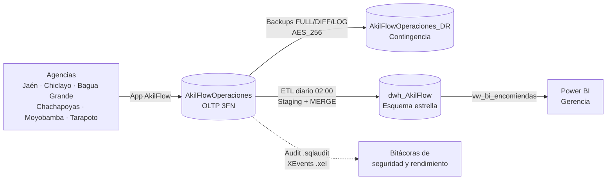

**Objetivo general.** Diseñar e implementar en T-SQL una plataforma de datos para Transportes Akil S.A.C. que asegure la integridad, la confidencialidad, la disponibilidad y el valor analítico de su información operativa.

**Objetivos específicos.**
1. Describir la organización y proponer el puesto de DBA con funciones estratégicas.
2. Implementar un modelo OLTP en 3FN con índices clúster y no clúster medidos con planes de ejecución.
3. Aplicar seguridad perimetral en 2 capas con 4 roles RBAC y cifrar los datos personales con AES_256.
4. Configurar auditoría, monitoreo con Extended Events y un plan DRP con backups cifrados y restauración verificada.
5. Construir un Data Warehouse en esquema estrella con ETL automatizado y consultas OLAP.

**Entregables técnicos** (carpeta `01_Scripts_SQL_Limpios/`, se ejecutan en orden y ya fueron probados de principio a fin sin errores no controlados en SQL Server 2022):

| Script | Contenido | Criterio |
|---|---|:-:|
| `01_OLTP_Estructura_Datos_Indices.sql` | 7 tablas 3FN, 697 viajes, 6 485 encomiendas, 6 índices no clúster, demo de plan | 2 |
| `02_Seguridad_RBAC_Cifrado.sql` | 4 logins, 4 users, 4 roles, DMK + certificado + AES_256, pruebas Msg 229/230 | 3 |
| `03_Auditoria_ExtendedEvents_DRP.sql` | Server/DB Audit, XE > 2 s, backups cifrados, restauración NORECOVERY/RECOVERY | 4 |
| `04_DWH_EsquemaEstrella_ETL.sql` | Staging, 5 dimensiones con SK, hechos, ETL `MERGE`, Job del Agent, conciliación | 5 |
| `05_Consultas_OLAP_BI.sql` | ROLLUP, CUBE, LAG, SUM OVER, RANK, NTILE, vista BI, `Rol_Analista_BI` | 5 |

---

## 2. Criterio 1 — Perfil empresarial, organigramas y puesto DBA

### 2.1 Perfil corporativo de Transportes Akil S.A.C.

| Campo | Detalle |
|---|---|
| **Razón social** | Transportes Akil S.A.C. |
| **RUC** | 20601234567 (dato de laboratorio) |
| **Sede central** | Av. Mesones Muro 1250, Jaén, Cajamarca |
| **Giro** | Transporte terrestre de carga y encomiendas (CIIU 4923). Servicios: encomienda puerta a puerta, carga consolidada, documentos y valores declarados. |
| **Cobertura** | Corredor norte y nororiente del Perú: **Jaén** (Cajamarca), **Chiclayo** (Lambayeque), **Bagua Grande** y **Chachapoyas** (Amazonas), **Moyobamba** y **Tarapoto** (San Martín). |
| **Red de rutas** | 10 rutas troncales de entre 75 km (Jaén–Bagua Grande) y 680 km (Chiclayo–Tarapoto). |
| **Flota** | 8 unidades: 3 pesadas (Volvo FH 460, Scania R450, Mercedes-Benz Actros), 3 medianas (Hino 500, VW Constellation, Foton Auman) y 2 livianas (Isuzu FVR, JAC N-Series). Capacidad total: 58.5 t. |
| **Personal** | 14 usuarios del sistema: gerencia, operaciones, contabilidad, DBA, 4 conductores y 6 despachadores (uno por agencia). |
| **Clientes clave** | Cooperativas cafetaleras y cacaoteras, ferreterías, boticas, distribuidoras de abarrotes y personas naturales. |
| **Estacionalidad** | **Campaña cafetalera (mayo–agosto)**: +40 % de encomiendas (sacos de café pergamino y plantones). **Campaña navideña (diciembre)**: +50 %. |
| **Volumen anual (2025)** | 3 264 encomiendas transportadas, ≈ 255 t de carga, ingresos de S/ 164 150. |

**Misión.** Conectar a productores y comercios del nororiente peruano con los mercados de la costa mediante un servicio de carga y encomiendas puntual, trazable y seguro.

**Visión al 2030.** Ser el operador logístico de referencia del corredor Chiclayo–Jaén–Tarapoto, con rastreo en línea y decisiones basadas en datos.

#### Problemática operativa (situación actual, *AS-IS*)

| # | Problema | Impacto | Solución en AkilFlow |
|:-:|---|---|---|
| P1 | Registro en Excel y cuadernos por agencia, con datos duplicados e inconsistentes | No hay una sola versión de la verdad | OLTP en 3FN con PK/FK/CHECK (Criterio 2) |
| P2 | El cliente llama varias veces para saber dónde está su encomienda | Consultas lentas, mala experiencia | Índices *covering* sobre estado y fecha (Criterio 2) |
| P3 | Nombres, DNI y teléfonos de los clientes a la vista de cualquier empleado | Riesgo de sanción por la Ley N.° 29733 | RBAC con 4 roles y cifrado AES_256 (Criterio 3) |
| P4 | Si se pierde un paquete no se sabe quién modificó el registro | No se puede probar quién hizo qué (no repudio) | SQL Server Audit (Criterio 4) |
| P5 | No hay backups; un fallo de disco borraría todo el historial | Pérdida total del negocio | DRP con FULL/DIFF/LOG cifrados y regla 3-2-1 (Criterio 4) |
| P6 | La gerencia no sabe qué rutas pierden dinero | Precios y frecuencias decididos "a ojo" | DWH + OLAP + Power BI (Criterio 5) |

### 2.2 Organigrama general

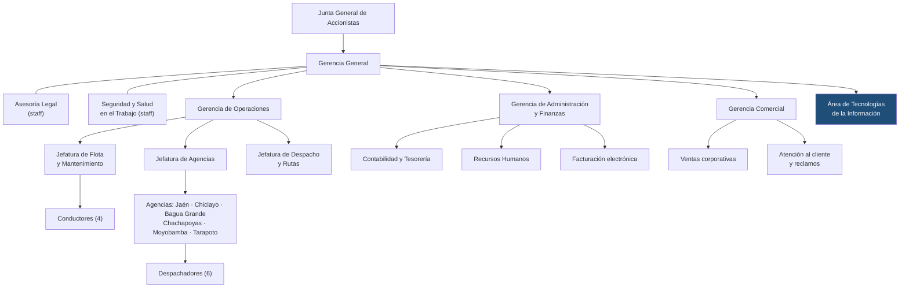

### 2.3 Organigrama del Área de TI

El Área de TI depende directamente de la Gerencia General porque sus sistemas dan servicio a todas las gerencias. El **DBA es un puesto nuevo que proponemos** y que reporta a la Jefatura de TI.

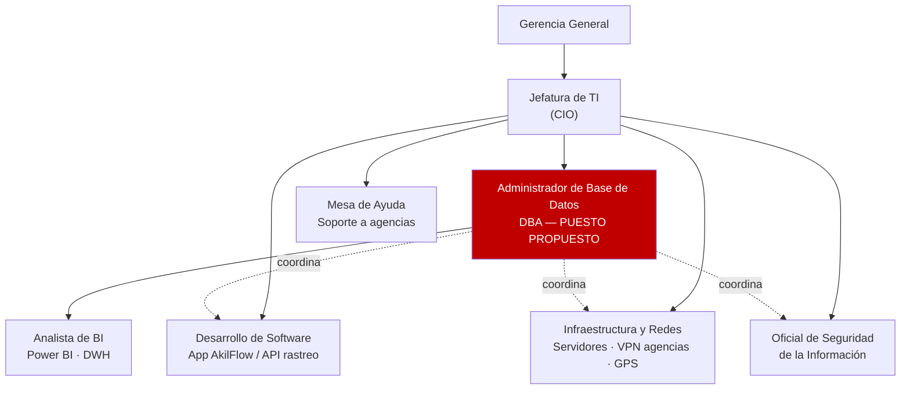

**Ficha del puesto propuesto**

| Campo | Descripción |
|---|---|
| **Denominación** | Administrador de Base de Datos (DBA) — SQL Server |
| **Reporta a** | Jefe de TI |
| **Supervisa a** | Analista de BI |
| **Coordina con** | Oficial de Seguridad (auditoría y cifrado), Infraestructura (almacenamiento y backups off-site), Desarrollo (consultas y despliegues) |
| **Perfil** | Bachiller en Ingeniería de Sistemas; certificación deseable: *Microsoft Certified: Azure Database Administrator Associate (DP-300)*; 2 años administrando SQL Server. |
| **Competencias** | T-SQL avanzado, optimización de consultas, seguridad (RBAC, cifrado), HA/DR, modelado dimensional, trabajo bajo presión en incidentes. |
| **Objetivo del puesto** | Garantizar que los datos de AkilFlow estén **disponibles** (RTO ≤ 1 h), **íntegros**, **confidenciales** y **útiles** para la toma de decisiones. |

### 2.4 Decálogo del DBA de Transportes Akil

| N.° | Función estratégica | Aplicación concreta en Transportes Akil | Implementación en el proyecto | Indicador (KPI) |
|:-:|---|---|---|---|
| 1 | **Diseño y gobierno del modelo de datos** | Mantener `AkilFlowOperaciones` en 3FN, aprobar todo cambio de esquema (por ejemplo, una nueva agencia en Cajamarca) y documentar el diccionario de datos. | Script 01: 7 tablas, 53 restricciones PK/FK/UNIQUE/CHECK/DEFAULT. | 0 anomalías de actualización; 100 % de tablas documentadas. |
| 2 | **Optimización del rendimiento** | Lograr que la pantalla "¿dónde está mi encomienda?" responda en menos de 1 s en las 6 agencias, aun en campaña cafetalera. | Índices *covering*, filtrados y de FK; comparación de planes (189 → 2 lecturas lógicas). | Percentil 95 de respuesta < 1 s; 0 consultas > 2 s por día. |
| 3 | **Seguridad y control de acceso (RBAC)** | Dar a cada puesto (despachador, jefe de operaciones, auditor, contador) solo lo que necesita y revisar los permisos cada trimestre. | Script 02: 2 capas, 4 roles, `GRANT`/`DENY` por objeto y por columna. | 0 permisos directos a usuarios; revisión trimestral firmada. |
| 4 | **Protección de datos personales** | Cumplir la Ley N.° 29733 cifrando nombre, DNI/RUC y teléfono de remitentes y destinatarios. | DMK → certificado → `SymKey` AES_256; columnas `VARBINARY(256)`; texto plano eliminado. | 100 % de PII cifrada; 0 columnas sensibles en texto plano. |
| 5 | **Auditoría y trazabilidad** | Saber quién consultó, modificó o intentó borrar una encomienda (no repudio ante reclamos y robos). | Script 03: `Audit_AkilFlow` + especificaciones de servidor y base. | 100 % de DML crítico auditado; revisión semanal de intentos con `succeeded = 0`. |
| 6 | **Monitoreo proactivo** | Detectar consultas lentas antes de que las agencias reporten que "el sistema está lento". | Sesión `XE_ConsultasLentas_AkilFlow` (> 2 s). | Tiempo medio de detección < 24 h. |
| 7 | **Respaldo y recuperación (DRP)** | Asegurar que un fallo de disco o un ransomware no borre el historial de la empresa. | FULL semanal, DIFF diario, LOG cada 15 min, cifrados AES_256, regla 3-2-1. | RPO ≤ 15 min; RTO ≤ 60 min; 1 simulacro trimestral exitoso. |
| 8 | **Continuidad e integridad física** | Detectar a tiempo la corrupción de páginas, el crecimiento del log y la falta de espacio en disco. | `CHECKSUM` en backups, `RESTORE VERIFYONLY`, `DBCC CHECKDB` en la base DR. | 0 errores de `CHECKDB`; espacio libre > 20 %. |
| 9 | **Inteligencia de negocios** | Entregar a la gerencia la rentabilidad por ruta, sucursal, vehículo y temporada. | Script 04–05: DWH estrella, ETL `MERGE` diario, OLAP, vista para Power BI. | ETL diario exitoso ≥ 99 %; conciliación Staging = Fact. |
| 10 | **Automatización, documentación y capacitación** | Programar tareas (ETL, backups), mantener *runbooks* de recuperación y capacitar a despachadores y analistas. | Job `ETL_AkilFlow_Diario` (02:00), scripts idempotentes y comentados, este informe. | 100 % de tareas críticas automatizadas; 1 capacitación por semestre. |

---

## 3. Criterio 2 — Diseño OLTP e indexación T-SQL

### 3.1 Modelo entidad-relación (3FN)

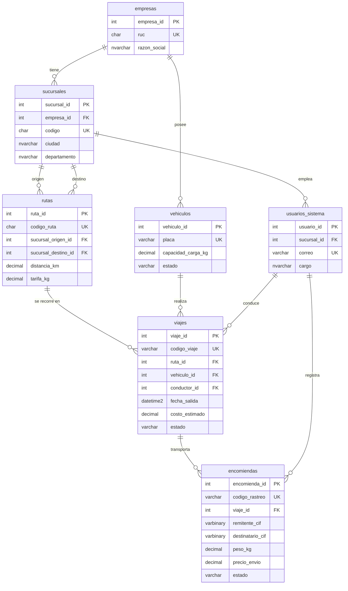

### 3.2 Justificación de la normalización

| Forma normal | Cómo se cumple en AkilFlow |
|---|---|
| **1FN** | Todos los atributos son atómicos. No hay listas de encomiendas dentro de un viaje: cada encomienda es una fila con su propio `codigo_rastreo`. |
| **2FN** | Todas las PK son simples (`INT IDENTITY`), así que no puede haber dependencias parciales. |
| **3FN** | Se eliminaron las dependencias transitivas: **(a)** `distancia_km`, `horas_estimadas` y `tarifa_kg` dependen de la **ruta** y no del viaje, por eso se creó la tabla `rutas` (en el avance anterior, origen y destino eran texto libre dentro de `viajes`); **(b)** `usuarios_sistema` no guarda `empresa_id` porque se obtiene vía `sucursal → empresa`; **(c)** la ciudad pertenece a la `sucursal`, no al viaje. |

### 3.3 Restricciones de integridad implementadas

| Tipo | Cantidad | Ejemplos relevantes |
|---|:-:|---|
| `PRIMARY KEY CLUSTERED` | 7 | `PK_encomiendas (encomienda_id)` |
| `FOREIGN KEY` | 10 | `FK_rutas_origen` / `FK_rutas_destino` (doble relación con `sucursales`), `FK_viajes_conductor` |
| `UNIQUE` | 9 | `UQ_rutas_par (sucursal_origen_id, sucursal_destino_id)`: impide registrar la misma ruta dos veces |
| `CHECK` | 16 | `CK_rutas_distinto` (origen ≠ destino), `CK_viajes_fechas` (llegada > salida), `CK_encomiendas_peso` (0 < peso ≤ 5000), `CK_empresas_ruc` (11 dígitos numéricos) |
| `DEFAULT` | 11 | `DF_encomiendas_estado = 'recibida'`, `DF_encomiendas_fecha = SYSDATETIME()` |

**Datos de prueba.** Se generan de forma **determinística** (sin `RAND()`), así todos los integrantes obtienen exactamente los mismos resultados en la demo: 697 viajes diarios (01/01/2025 – 28/11/2026, con un 4 % de cancelados) y 6 485 encomiendas. La carga respeta la estacionalidad real: +3 encomiendas por viaje en la campaña del café, +4 en diciembre y +1 de crecimiento en 2026. La fase 7.3 del script prueba que el `CHECK` rechaza un peso negativo (**Msg 547**).

### 3.4 Estrategia de indexación

| Índice | Tipo | Columnas clave | `INCLUDE` / filtro | Consulta de negocio que acelera |
|---|---|---|---|---|
| `PK_*` (7) | **Clúster** | `*_id INT IDENTITY` | — | Acceso por PK y JOIN. La clave es estrecha (4 bytes), única, estática y creciente: no provoca *page splits* y los punteros de los no clúster son pequeños. |
| `IX_encomiendas_estado_fecha` | No clúster *covering* | `estado, fecha_registro` | `codigo_rastreo, peso_kg, precio_envio` | Seguimiento: "encomiendas en tránsito desde X" |
| `IX_encomiendas_viaje` | No clúster (FK) | `viaje_id` | `peso_kg, precio_envio, estado` | JOIN viajes–encomiendas en el ETL y en el manifiesto de carga |
| `IX_encomiendas_pendientes` | No clúster **filtrado** | `usuario_registro_id, fecha_registro` | `WHERE estado = 'recibida'` | Bandeja de pendientes por agencia. Indexa solo unas 35 filas de 6 485. |
| `IX_viajes_fecha_salida` | No clúster | `fecha_salida` | `ruta_id, vehiculo_id, costo_estimado, estado` | Reportes por rango de fechas y extracción del ETL |
| `IX_viajes_vehiculo_fecha` | No clúster compuesto | `vehiculo_id, fecha_salida` | `estado` | Agenda de cada unidad (evita asignarla dos veces) |
| `IX_viajes_ruta` | No clúster (FK) | `ruta_id` | — | JOIN con `rutas` y borrado seguro en la tabla padre |
| `UQ_*` (9) | No clúster único | claves de negocio | — | Búsqueda por `codigo_rastreo`, `placa`, `ruc` |

### 3.5 Impacto en el plan de ejecución (antes vs. después)

**Consulta de prueba** (pantalla de seguimiento del despachador):

```sql
SELECT codigo_rastreo, fecha_registro, peso_kg, precio_envio, estado
FROM dbo.encomiendas
WHERE estado = 'en_transito' AND fecha_registro >= '2026-11-23';   -- 15 filas de 6 485
```

Valores **medidos** con `SET STATISTICS IO ON` y el plan real (`Ctrl + M`) en SQL Server 2022:

| Etapa | Índice disponible | Operador del plan | Lecturas lógicas | Mejora |
|---|---|---|:-:|:-:|
| **ANTES** | Solo `PK_encomiendas` | **Clustered Index Scan**: recorre las 6 485 filas y filtra después | **189** | — |
| **INTERMEDIO** | `IX (estado, fecha_registro)` sin `INCLUDE` | **Index Seek** + **Key Lookup** (*Nested Loops*): ubica 15 filas y salta 15 veces al clúster por `peso_kg` y `precio_envio` | **32** | −83 % |
| **DESPUÉS** | `IX ... INCLUDE (codigo_rastreo, peso_kg, precio_envio)` | **Index Seek (NonClustered)**: el índice "cubre" la consulta y no hay Key Lookup | **2** | **−99 %** |


**Análisis técnico.**
- El **orden de las columnas clave** importa: `estado` va primero porque es un predicado de igualdad, y `fecha_registro` va segundo porque es un rango. Así el *Seek* posiciona el inicio y lee un tramo contiguo del árbol B+.
- El **Key Lookup** cuesta una lectura aleatoria por fila. Con 15 filas es aceptable, pero el optimizador cambiaría a *Scan* cuando la selectividad empeore (el *tipping point* suele estar entre el 25 % y el 33 % de las páginas). El `INCLUDE` elimina ese riesgo **sin ensanchar la clave** del índice, porque las columnas incluidas solo viven en el nivel hoja.
- Costo a considerar: cada índice adicional se mantiene en cada `INSERT`/`UPDATE`. En una OLTP con muchas más lecturas que escrituras (≈ 20 consultas de rastreo por cada encomienda registrada) el balance es claramente positivo.
- El **índice filtrado** demuestra la indexación selectiva: solo almacena las encomiendas `recibida` (3 lecturas lógicas para la bandeja de una agencia).

---

## 4. Criterio 3 — Seguridad perimetral RBAC y cifrado AES_256

### 4.1 Modelo perimetral en 2 capas

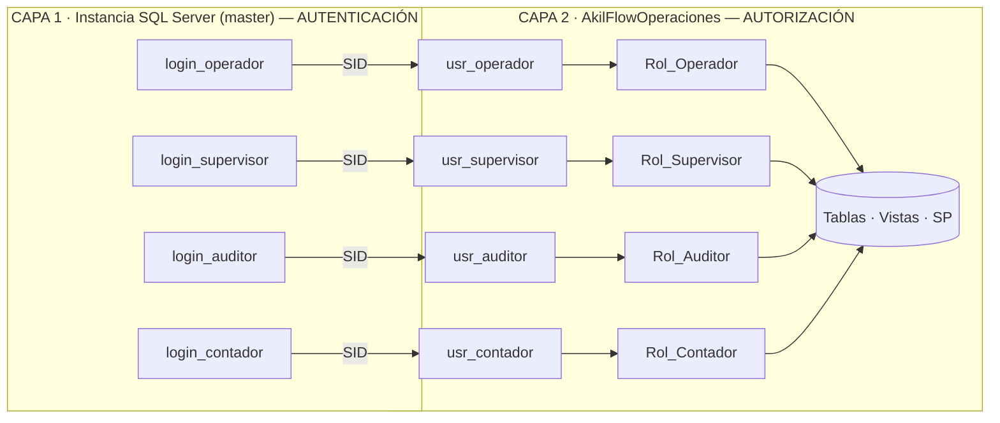

- **Capa 1 — `LOGIN`**: responde a "¿quién eres?" a nivel de instancia. Se crea con `CHECK_POLICY = ON`, que aplica la política de contraseñas de Windows.
- **Capa 2 — `USER`**: responde a "¿qué puedes hacer en esta base?". Se mapea al login por su SID. Un login sin user no puede entrar a la base (defensa en profundidad).
- **Los permisos nunca se asignan a usuarios**, siempre a **roles**. Cuando un despachador renuncia, basta con `ALTER ROLE ... DROP MEMBER`.

### 4.2 Matriz RBAC (principio de mínimo privilegio)

| Objeto / acción | `Rol_Operador`<br/>(despachador) | `Rol_Supervisor`<br/>(jefe de operaciones) | `Rol_Auditor`<br/>(control interno) | `Rol_Contador`<br/>(finanzas) |
|---|:-:|:-:|:-:|:-:|
| `SELECT` sucursales, rutas, vehículos, viajes | ✅ | ✅ | ✅ | ✅ |
| `SELECT` encomiendas | ✅ | ✅ | ✅ (PII solo en binario) | ⚠️ solo columnas no sensibles |
| `SELECT` columnas `*_cif` | ✅ (binario) | ✅ (binario) | ✅ (binario) | ⛔ **DENY de columna (Msg 230)** |
| `SELECT` usuarios_sistema | ⛔ DENY | ✅ | ✅ | ⛔ DENY |
| `INSERT` encomiendas directo | ⛔ DENY (obliga a usar el SP) | — | ⛔ DENY | ⛔ DENY |
| `UPDATE` encomiendas | ⚠️ solo `estado, viaje_id` | ⚠️ solo `estado, viaje_id` | ⛔ DENY | ⛔ DENY |
| `INSERT/UPDATE` viajes, vehículos, rutas | ⚠️ solo `UPDATE(estado)` de viajes | ✅ | ⛔ DENY | ⛔ DENY |
| `DELETE` (cualquier tabla) | ⛔ DENY | ⛔ DENY (borrado lógico) | ⛔ DENY | ⛔ DENY |
| `ALTER` (DDL) | — | ⛔ DENY | — | — |
| `EXECUTE` `usp_registrar_encomienda` | ✅ | ✅ | ⛔ DENY | ⛔ DENY |
| `EXECUTE` `usp_consultar_encomienda` (descifra) | ✅ | ✅ | ⛔ DENY | ⛔ DENY |
| `SELECT` `vw_resumen_financiero_viajes` | ⛔ DENY | ✅ | ✅ | ✅ |

**Granularidad aplicada:** permisos a nivel de **esquema** (`ON SCHEMA::dbo`), de **objeto**, de **columna** (`GRANT UPDATE (estado, viaje_id)`, `DENY SELECT (remitente_cif, ...)`) y de **módulo** (`EXECUTE` sobre los SP). `DENY` siempre prevalece sobre cualquier `GRANT`, aunque venga de otro rol.

### 4.3 Jerarquía de cifrado AES_256

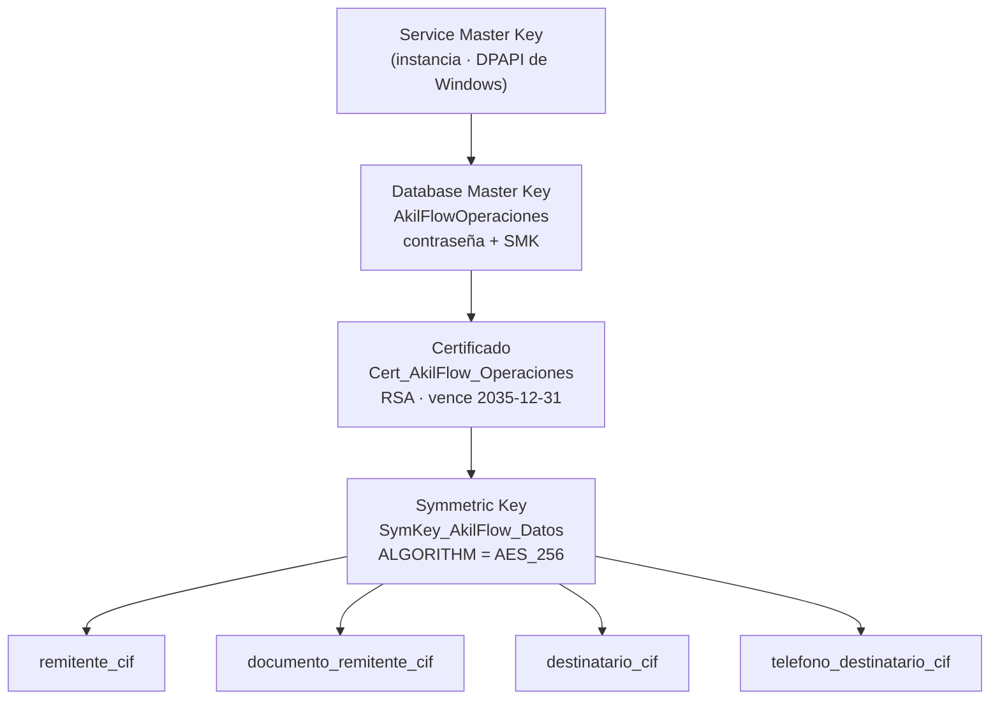

**¿Por qué cifrado simétrico protegido por un certificado?** AES_256 es rápido para cifrar miles de filas. El certificado (asimétrico) protege la llave simétrica, y la DMK protege al certificado. Así, para descifrar hay que abrir la cadena completa, y cada eslabón se puede rotar sin tocar los demás.

### 4.4 Migración segura: cero datos en texto plano

| Paso | Sentencia clave | Evidencia |
|:-:|---|---|
| 1 | `ALTER TABLE ... ADD remitente_cif VARBINARY(256) ...` | 4 columnas binarias nuevas |
| 2 | `OPEN SYMMETRIC KEY` + `UPDATE ... EncryptByKey(Key_GUID('SymKey_AkilFlow_Datos'), remitente)` | Dentro de una **transacción** |
| 3 | **Validación round-trip**: `CAST(DecryptByKey(x) AS NVARCHAR) <> original` | 0 filas inconsistentes, así que `COMMIT` (si no, `ROLLBACK`) |
| 4 | `ALTER TABLE ... DROP COLUMN remitente, documento_remitente, destinatario, telefono_destinatario` | Se eliminan las columnas en texto plano |
| 5 | `ALTER INDEX ALL ON dbo.encomiendas REBUILD` | **Purga los bytes residuales**: `DROP COLUMN` solo cambia los metadatos y los datos siguen físicamente en las páginas hasta el *rebuild* |
| 6 | `SELECT ... FROM sys.columns` | Solo existen las columnas `*_cif` de tipo `varbinary(256)` |

**Inserciones futuras.** El operador **no puede** hacer `INSERT` directo (DENY). Debe usar `dbo.usp_registrar_encomienda`, creado `WITH EXECUTE AS OWNER`: el procedimiento abre la llave, cifra y la cierra dentro del servidor, sin que el usuario reciba permisos sobre el certificado ni la llave. Los parámetros se limitan a `NVARCHAR(80)` para que el texto cifrado (texto + relleno + IV de 16 bytes + encabezado) no supere los 256 bytes.

### 4.5 Pruebas de seguridad (resultados reales)

| Usuario | Acción intentada | Resultado |
|---|---|---|
| `usr_operador` | `EXEC usp_registrar_encomienda` y `usp_consultar_encomienda` | ✅ Registra cifrado y consulta descifrado |
| `usr_operador` | `DELETE FROM encomiendas` | ⛔ **Msg 229**: *The DELETE permission was denied on the object 'encomiendas'* |
| `usr_operador` | `INSERT` directo (saltándose el cifrado) | ⛔ **Msg 229** (INSERT) |
| `usr_operador` | `UPDATE encomiendas SET precio_envio = 0` | ⛔ **Msg 230**: *denied on the column 'precio_envio'* |
| `usr_auditor` | `SELECT remitente_cif, DecryptByKey(...)` | ✅ Ve `0x000E4F56...` y el descifrado devuelve `NULL` |
| `usr_auditor` | `OPEN SYMMETRIC KEY` | ⛔ **Msg 15151**: *Cannot find the symmetric key ... or you do not have permission* |
| `usr_auditor` | `UPDATE` / `EXEC usp_consultar_encomienda` | ⛔ **Msg 229** |
| `usr_contador` | `SELECT` sobre `vw_resumen_financiero_viajes` | ✅ |
| `usr_contador` | `SELECT remitente_cif` | ⛔ **Msg 230** (DENY a nivel de columna) |
| `usr_supervisor` | `UPDATE vehiculos` / `DELETE viajes` | ✅ / ⛔ **Msg 229** |

**Comparación con otras alternativas de cifrado:** **TDE** cifra los archivos `.mdf/.ldf` en reposo (protege contra robo del disco, pero cualquier usuario con `SELECT` ve el texto plano). **Always Encrypted** cifra desde el cliente y ni el DBA ve los datos, pero exige cambiar el driver de la aplicación. **El cifrado de columnas con `EncryptByKey`**, el que elegimos, protege campos puntuales dentro del servidor y combina con RBAC: el auditor puede auditar sin ver los datos personales.

---

## 5. Criterio 4 — Auditoría, monitoreo y Plan DRP

### 5.1 SQL Server Audit

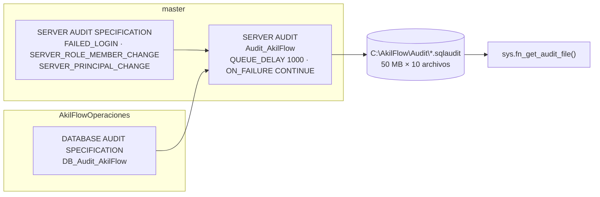

| Especificación | Acciones auditadas | Justificación |
|---|---|---|
| Servidor | `FAILED_LOGIN_GROUP`, `SERVER_ROLE_MEMBER_CHANGE_GROUP`, `SERVER_PRINCIPAL_CHANGE_GROUP` | Detectar ataques de fuerza bruta y escaladas de privilegio |
| Base | `SELECT, INSERT, UPDATE, DELETE ON dbo.encomiendas BY public` | Toda manipulación de encomiendas (reclamos, pérdidas) |
| Base | `SELECT, UPDATE, DELETE ON dbo.viajes BY public` | Cambios en costos y estados de viaje |
| Base | `EXECUTE ON dbo.usp_consultar_encomienda` | Saber **quién vio datos personales descifrados** |
| Base | `DATABASE_ROLE_MEMBER_CHANGE_GROUP`, `SCHEMA_OBJECT_PERMISSION_CHANGE_GROUP` | Cambios en el modelo RBAC (GRANT/DENY/REVOKE) |

**Prueba DML (antes vs. después) y bitácora obtenida:**

| Momento | `AK20261125PEND01` | `AK20261125DEMO01` |
|---|---|---|
| **ANTES** | `viaje_id = NULL`, `recibida` | existe, `recibida` |
| **DESPUÉS** | `viaje_id = 693`, `en_transito` | eliminada |

| `action_id` | `succeeded` | `usuario_bd` | Objeto | Interpretación |
|:-:|:-:|---|---|---|
| `UP` | 1 | dbo | encomiendas | Asignación de la encomienda al viaje en curso |
| `DL` | 1 | dbo | encomiendas | Eliminación autorizada de la encomienda demo |
| `SL` | 1 | usr_operador | encomiendas | Consulta del operador |
| **`DL`** | **0** | **usr_operador** | encomiendas | **Intento de borrado denegado y registrado**: prueba de no repudio |
| `SL` | 1 | usr_auditor | viajes | Revisión del auditor |

Ventajas frente a *triggers*: la auditoría es asíncrona (`QUEUE_DELAY`), no se puede desactivar con `DISABLE TRIGGER`, registra también los **intentos fallidos** y los `SELECT` (un trigger no puede capturar lecturas).

### 5.2 Extended Events — consultas mayores a 2 segundos

```sql
CREATE EVENT SESSION XE_ConsultasLentas_AkilFlow ON SERVER
ADD EVENT sqlserver.sql_statement_completed (
    ACTION (sqlserver.sql_text, sqlserver.database_name, sqlserver.username, sqlserver.client_app_name)
    WHERE ([duration] > (2000000) AND [sqlserver].[database_name] = N'AkilFlowOperaciones')),
ADD EVENT sqlserver.rpc_completed (...)
ADD TARGET package0.event_file (SET filename = N'C:\AkilFlow\XEvents\XE_ConsultasLentas_AkilFlow.xel')
WITH (MAX_DISPATCH_LATENCY = 1 SECONDS, STARTUP_STATE = ON);
```

| Decisión | Justificación |
|---|---|
| `duration > 2000000` | `duration` es un **campo del evento** expresado en **microsegundos**: 2 s = 2 000 000 µs. |
| Predicado en el `WHERE` | Se evalúa **antes** de enviar el evento al destino, así que las consultas rápidas no generan costo de E/S (Profiler/Trace filtran después). |
| `sql_statement_completed` + `rpc_completed` | Cubre los lotes ad hoc de SSMS y las llamadas de la aplicación AkilFlow a procedimientos. |
| `event_file` + `STARTUP_STATE = ON` | Persiste en disco y se reinicia sola con el servicio. |

**Resultado:** `SELECT COUNT(*)` (ms) **no** se captura; `WAITFOR DELAY '00:00:03'` **sí** se captura con `duracion_seg = 3.00`, usuario y aplicación. Se lee con `sys.fn_xe_file_target_read_file` y XQuery (`event/data[@name="duration"]/value`).

### 5.3 Estrategia de respaldos cifrados

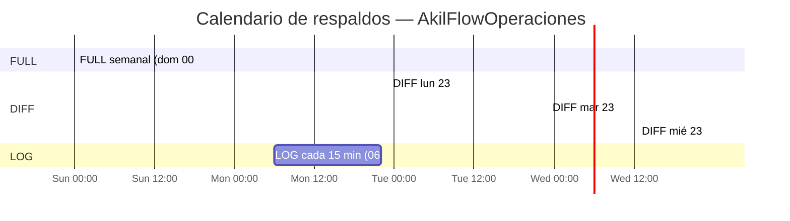

| Tipo | Frecuencia | Contenido | Tamaño medido (lab) | Cifrado |
|---|---|---|:-:|---|
| **FULL** | Domingo 00:00 | Base completa + porción del log | 2.92 MB (1 386 páginas) | `AES_256`, `CertBackupServer_AkilFlow` |
| **DIFFERENTIAL** | Diario 23:00 | Extensiones modificadas desde el último FULL | 0.17 MB (154 páginas) | `AES_256` |
| **LOG** | Cada 15 min | Transacciones desde el último LOG | 0.05 MB (11 páginas) | `AES_256` |

Todos los respaldos usan `CHECKSUM` (detecta corrupción al escribir), `COMPRESSION` y `RESTORE VERIFYONLY`. La cadena LSN se valida en `msdb.dbo.backupset`: `database_backup_lsn` del DIFF y del LOG = `first_lsn` del FULL.

**El certificado es la llave del DRP.** `BACKUP CERTIFICATE ... WITH PRIVATE KEY` lo exporta a `C:\AkilFlow\Keys\`. **Sin ese archivo los `.bak` cifrados no se pueden restaurar en otro servidor**, por eso se custodia por separado de los backups (bóveda o gestor de secretos).

### 5.4 Restauración secuencial (simulacro de desastre)

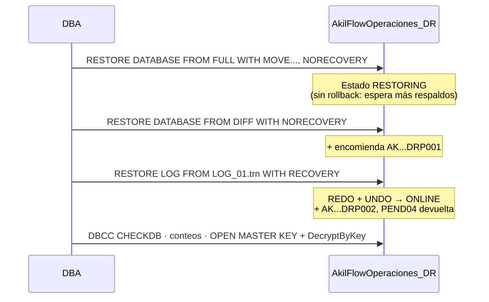

- **`NORECOVERY`** deja la base en *Restoring* y **no deshace** las transacciones abiertas, porque el siguiente respaldo podría completarlas.
- **`RECOVERY`** (solo en el último eslabón) ejecuta *redo/undo* y pone la base **ONLINE**. Si se usara `RECOVERY` en el FULL, ya no se podría aplicar el DIFF ni el LOG.

**Validación post-desastre (resultados reales):**

| Verificación | Producción | Contingencia DR | Resultado |
|---|:-:|:-:|:-:|
| Filas en `encomiendas` | 6 487 | 6 487 | ✅ |
| Filas en `viajes` | 697 | 697 | ✅ |
| `DBCC CHECKDB` | — | 0 errores | ✅ |
| `AK20261125DRP001` (insertada tras el FULL) | ✓ | Recuperada por el DIFF | ✅ |
| `AK20261125DRP002` (insertada tras el DIFF) | ✓ | Recuperada por el LOG | ✅ |
| Descifrado de remitente y destinatario | ✓ | `OPEN MASTER KEY` + `ALTER MASTER KEY ADD ENCRYPTION BY SERVICE MASTER KEY` | ✅ |

### 5.5 Regla 3-2-1 aplicada a Transportes Akil

| Componente | Requisito | Implementación propuesta | Riesgo que mitiga |
|---|---|---|---|
| **3** copias | Producción + 2 respaldos | (1) Datos vivos en el servidor de Jaén. (2) Respaldo en `C:\AkilFlow\Backups` (disco local separado). (3) Copia externa. | Error humano o corrupción de una copia |
| **2** medios distintos | Dos tecnologías de almacenamiento | Disco local del servidor + **NAS** de la sede Jaén (copia por *robocopy* programado) | Falla del disco o de la controladora |
| **1** fuera del sitio | Una copia en otra ubicación | **Azure Blob Storage** (`BACKUP TO URL`, ejemplo en el script 03) o disco rotativo custodiado en la agencia Chiclayo | Incendio, inundación, robo o ransomware en la sede |
| Extensión **3-2-1-1-0** | 1 inmutable, 0 errores | Blob con política de inmutabilidad (WORM) + `RESTORE VERIFYONLY` y simulacro trimestral | Ransomware que cifra los respaldos en línea |
| Llaves | Custodia separada | `.cer/.pvk` del certificado en una bóveda distinta de los `.bak` | Respaldos cifrados irrecuperables |

### 5.6 Cálculo justificado de RPO y RTO

**Supuestos de negocio (proyección de producción):** 6 agencias atienden de 06:00 a 22:00 (16 h). En campaña se registran ≈ 400 encomiendas/día, es decir, unas **25 encomiendas por hora** en toda la red. La base de producción proyectada pesa ≈ 5 GB (historial de 5 años con fotos de guías fuera de la base). Se restaura en un servidor con SSD a ≈ 150 MB/s.

**RPO (Recovery Point Objective): máxima pérdida de datos tolerable.**

| Escenario | Fórmula | Pérdida |
|---|---|---|
| Sin backups de LOG (solo DIFF diario) | hasta 24 h × 25 enc/h | ≈ 600 encomiendas: **inaceptable** |
| **LOG cada 15 min (diseño)** | 15 min × 25 enc/h ÷ 60 | **≈ 6 encomiendas**: se re-digitan desde la guía física en menos de 10 min |
| Con *tail-log backup* (el disco del log sobrevive) | `BACKUP LOG ... WITH NO_TRUNCATE` | ≈ 0 |

**RPO = 15 minutos.** Es el equilibrio entre la pérdida tolerable y la sobrecarga operativa (96 archivos de log al día, de pocos MB cada uno).

**RTO (Recovery Time Objective): tiempo máximo para volver a operar.** Peor caso: falla a las 22:59 del sábado (FULL del domingo anterior + DIFF del viernes 23:00 + 96 LOG).

| Actividad | Cálculo | Tiempo |
|---|---|:-:|
| Detección y decisión de activar el DRP | Alerta + llamada al DBA | 10 min |
| Restaurar FULL (5 GB, cifrado y comprimido) | 5 120 MB ÷ 150 MB/s ≈ 34 s + descifrado y descompresión | 3 min |
| Restaurar DIFF (≈ 600 MB) | `NORECOVERY` | 1 min |
| Restaurar 96 LOG (≈ 5 MB c/u) | ≈ 5 s × 96 | 8 min |
| `RECOVERY` + `DBCC CHECKDB` | Integridad | 10 min |
| Re-vincular DMK, validar descifrado y conteos | Script de la fase 6 | 5 min |
| Redirigir la aplicación (DNS / cadena de conexión) y pruebas en agencias | Prueba de humo | 13 min |
| **Total** | | **≈ 50 min** |

**RTO = 60 minutos** (50 min calculados + 10 min de holgura). En el laboratorio, la cadena completa FULL → DIFF → LOG se restauró en **menos de 1 segundo** (11 MB), lo que valida el procedimiento. El tiempo en producción depende sobre todo del volumen y del tiempo de detección.

---

## 6. Criterio 5 — Data Warehouse, ETL y consultas OLAP

### 6.1 Arquitectura de 3 capas

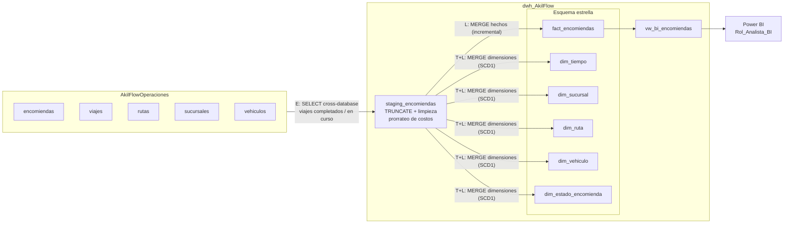

Se respetan los 4 pilares de Inmon: **orientado al tema** (rentabilidad de encomiendas), **integrado** (códigos homologados con `UPPER/LTRIM/RTRIM`), **variante en el tiempo** (`dim_tiempo` 2024–2027) y **no volátil** (la fuente es la OLTP; el analista no puede escribir).

### 6.2 Esquema estrella

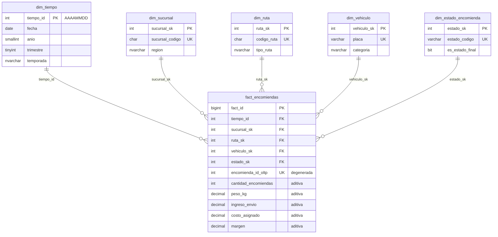

**Grano:** 1 fila = 1 encomienda transportada.

### 6.3 Decisiones de diseño BI

| Decisión | Alternativa descartada | Justificación |
|---|---|---|
| **Claves subrogadas** `INT IDENTITY` (`*_sk`) | Usar `sucursal_id` de la OLTP | Aísla el DWH de cambios o reutilización de claves operacionales, permite SCD y JOIN más angostos. La clave de negocio queda como `UNIQUE` para el `MERGE`. |
| `dim_tiempo` con clave inteligente `AAAAMMDD` | `IDENTITY` | Legible, ordenable y particionable. Se genera para 4 años sin depender de `@@DATEFIRST` (el lunes se calcula con `DATEDIFF` desde 01/01/1900). |
| Atributo **`temporada`** en `dim_tiempo` | Calcularla en cada reporte | Es la variable de negocio clave (café, Navidad): se calcula una vez y se reutiliza. |
| **Miembro desconocido** (SK = −1) | Descartar hechos huérfanos | No se pierden ingresos si llega una dimensión incompleta; se reporta como "N/D". |
| **Prorrateo de costos por peso** | Asignar el costo completo al viaje | El costo es del viaje, pero el grano es la encomienda: `costo_viaje × peso / SUM(peso) OVER (PARTITION BY viaje)` permite calcular el margen por encomienda y que se pueda sumar. |
| Excluir viajes **cancelados** | Incluirlos con ingreso 0 | No generan ingreso ni costo real y distorsionarían la ocupación. |
| **SCD Tipo 1** (sobrescribir) | SCD Tipo 2 (historial) | Los atributos (marca, distancia) casi no cambian y no tienen valor histórico para el análisis actual. |
| `MERGE` **incremental** de hechos | `TRUNCATE` + recarga total | Solo actualiza lo que cambió (en la prueba, 7 filas). Escala bien con el crecimiento. |
| `RECOVERY SIMPLE` en el DWH | `FULL` | El DWH se reconstruye desde la OLTP; no requiere restauración a un punto en el tiempo. |
| Vista **`vw_bi_encomiendas`** | Exponer las tablas | Un solo objeto desnormalizado y estable para Power BI que oculta los JOIN y el Staging. |

### 6.4 Proceso ETL (`dbo.usp_etl_akilflow`)

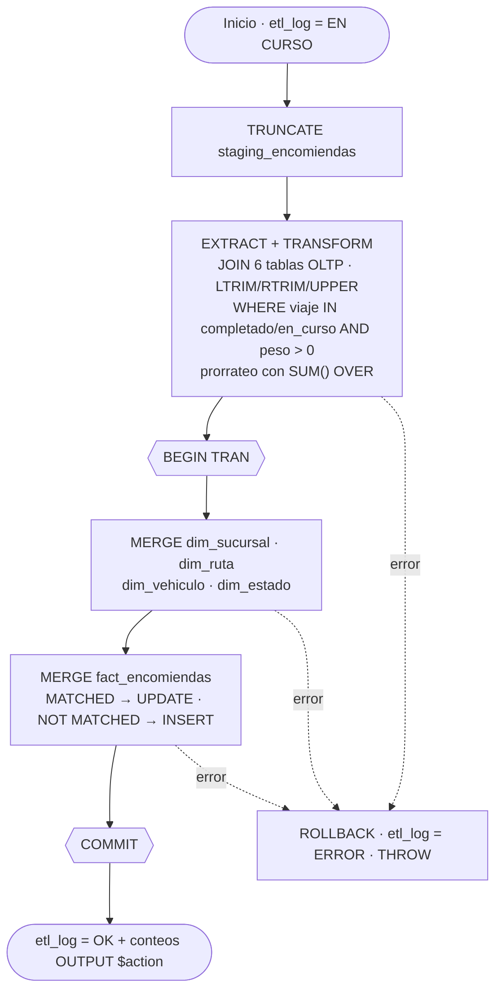

- **Automatización:** Job de SQL Server Agent `ETL_AkilFlow_Diario`, todos los días a las 02:00, con 2 reintentos. En la edición Express se usa el Programador de tareas de Windows con `sqlcmd`.
- **Atomicidad:** `SET XACT_ABORT ON` + `TRY/CATCH`: o se carga todo o no se carga nada.
- **Bitácora:** `etl_log` registra las filas de staging y las inserciones y actualizaciones de dimensiones y hechos (capturadas con `OUTPUT $action`).

**Conciliación (resultados reales):**

| Origen | Filas | Ingresos (S/) | Costos (S/) | Peso (kg) |
|---|:-:|:-:|:-:|:-:|
| Staging | 6 451 | 325 059.90 | 245 139.89 | 503 708.76 |
| Fact | 6 451 | 325 059.90 | 245 139.89 | 503 708.76 |
| **Diferencia** | **0** | **0.00** | **0.00** | **0.00** |

La diferencia entre el costo de los viajes en la OLTP (S/ 245 139.75) y el costo prorrateado (S/ 245 139.89) es de **S/ 0.14**, explicada por el redondeo a 2 decimales de cada prorrateo. Hechos con dimensión desconocida: **0**. **Carga incremental:** al completarse el viaje 693 en la OLTP, la segunda corrida insertó 0 hechos y actualizó 7.

### 6.5 Consultas OLAP y hallazgos de negocio

| # | Técnica | Pregunta de negocio | Hallazgo (datos reales del DWH) |
|:-:|---|---|---|
| Q1 | `GROUP BY ROLLUP (region, sucursal, ruta)` + `GROUPING()` | ¿Qué región, sucursal y ruta generan margen? | 2026: ingresos S/ 160 909.79 y margen **27.6 %**. **Nororiente Amazónico** aporta el 48 % de los ingresos. Jaén tiene 41.8 % de margen y Chiclayo solo 11.0 %. |
| Q2 | `GROUP BY CUBE (categoria, trimestre)` + `GROUPING_ID` | ¿Qué tipo de unidad rinde más en cada trimestre? | Las unidades **pesadas** generan el 46 % de los ingresos. T2–T3 (café) duplican el margen de T1. Las **livianas pierden dinero en T1 y T4**. |
| Q3 | `LAG(…,1)`, `LAG(…,12)`, `SUM() OVER (PARTITION BY anio ORDER BY mes)`, media móvil con `ROWS BETWEEN 2 PRECEDING` | ¿Cómo evolucionan los ingresos? | Mayo-2025: **+47.4 %** frente a abril (inicio de la campaña del café). Diciembre-2025: **+71.5 %**. Crecimiento interanual de 2026 entre +1 % y +24 %. |
| Q4 | `RANK()`, `DENSE_RANK()`, `SUM() OVER (PARTITION BY anio)` | ¿Qué rutas son más rentables? | **Paradoja:** CIX-TPP y TPP-CIX facturan el 37 % del total, pero ocupan los **últimos lugares en margen** (**TPP-CIX: −3.5 %**). Las rutas cortas BGR/JAE superan el 50 % de margen. |
| Q5 | `RANK()` + `NTILE(3)` | ¿Se aprovecha la flota? | La ocupación promedio es de solo **7 % – 16 %**: hay capacidad ociosa para consolidar carga. |
| Q6 | `ROW_NUMBER() OVER (PARTITION BY sucursal)` | Top 3 rutas por agencia | Bagua Grande es el *hub*: sus 3 rutas suman S/ 37 602 con 50 % de margen. |

**Recomendaciones gerenciales derivadas del DWH:**
1. **Reajustar la tarifa de Tarapoto–Chiclayo** (+12 %) o consolidar las salidas a días alternos para revertir el margen negativo.
2. **Asignar unidades livianas a las rutas cortas** y las pesadas a las largas solo en campaña cafetalera.
3. **Reforzar la flota entre mayo y agosto y en diciembre** (picos de +40 % a +70 %) con alquiler temporal en lugar de compra.
4. **Vender la capacidad ociosa** (ocupación < 20 %) a cooperativas con contratos de carga consolidada.

### 6.6 Seguridad del DWH

| Rol | `GRANT` | `DENY` | Prueba |
|---|---|---|---|
| `Rol_Analista_BI` (`login_analista_bi` → `usr_analista_bi`) | `SELECT ON SCHEMA::dbo` (vista, dimensiones, hechos) | `SELECT` en `staging_encomiendas` y `etl_log`; `INSERT/UPDATE/DELETE` en el esquema; `EXECUTE` en `usp_etl_akilflow` | Vista ✅ · Staging ⛔ **Msg 229** · ETL ⛔ **Msg 229** |

El Staging contiene datos crudos sin conciliar. Bloquearlo evita que se publiquen en Power BI cifras que no cuadran con el informe oficial.

---

## 7. Guía de ejecución en Windows

| Paso | Acción |
|:-:|---|
| 1 | Instalar **SQL Server 2022 Developer** (gratuito) y **SSMS 20**. *Express no soporta backups cifrados ni el Agent.* |
| 2 | (Opcional, para conectarse con los logins SQL) SSMS → clic derecho en el servidor → **Propiedades → Seguridad → "Modo de autenticación de SQL Server y Windows"** → reiniciar el servicio. |
| 3 | Abrir SSMS **como administrador** de la instancia (`sysadmin`). |
| 4 | Ejecutar con **F5**, en orden: `01` → `02` → `03` → `04` → `05`. Tiempo total ≈ 1 min (el script 03 incluye esperas de 3 s a propósito). |
| 5 | El script 03 crea automáticamente `C:\AkilFlow\{Audit, XEvents, Backups, Keys, DR}` con `xp_create_subdir` y la cuenta del servicio de SQL Server, así que no hace falta crear carpetas ni dar permisos NTFS. Si no tiene unidad `C:`, reemplace `C:\AkilFlow\` con **Ctrl + H**. |
| 6 | Para el plan de ejecución gráfico: **Ctrl + M** (Incluir plan de ejecución real) y ejecutar solo las fases 4–6 del script 01. |
| 7 | Todos los scripts son **idempotentes**: se pueden volver a ejecutar desde el 01 sin errores (cada uno limpia lo que crea). |

---

## 8. Conclusiones y recomendaciones

### Conclusiones

1. **Criterio 1.** Proponer el puesto de DBA con un decálogo medible convierte la gestión de datos de Transportes Akil en una función estratégica con indicadores (RPO, RTO, % de PII cifrada, éxito del ETL), alineada a sus problemas reales (P1–P6).
2. **Criterio 2.** El modelo en 3FN, con 7 tablas y 53 restricciones, elimina redundancias e impide datos inválidos (Msg 547). El *covering index* redujo las lecturas lógicas de **189 a 2 (−99 %)**, porque pasó de un *Clustered Index Scan* a un *Index Seek* sin *Key Lookup*.
3. **Criterio 3.** La seguridad en 2 capas con **4 roles RBAC** y permisos a nivel de esquema, objeto, columna y procedimiento aplica el mínimo privilegio: cada intento indebido devuelve Msg 229/230/15151. El cifrado AES_256, con DMK → certificado → llave simétrica y la eliminación del texto plano seguida de *rebuild*, deja **0 datos personales legibles** sin autorización.
4. **Criterio 4.** SQL Server Audit registró incluso los intentos **fallidos** (`succeeded = 0`). Extended Events captura solo las consultas de más de 2 s con un costo mínimo. La cadena FULL → DIFF → LOG cifrada se restauró en `AkilFlowOperaciones_DR` con integridad, conteos y descifrado verificados, lo que cumple un **RPO de 15 min** y un **RTO de 60 min**.
5. **Criterio 5.** El esquema estrella con claves subrogadas y el ETL `MERGE` incremental cuadran exactamente con el Staging (diferencia 0). Las consultas OLAP revelaron que la ruta de mayor facturación (Tarapoto–Chiclayo) **pierde dinero**, un hallazgo que no se veía en la OLTP.

### Recomendaciones

- Migrar a **Always On Availability Groups** (réplica en Chiclayo) para llevar el RTO a minutos.
- Activar **TDE** sobre las tres bases como capa adicional de cifrado en reposo.
- Evaluar **SCD Tipo 2** en `dim_vehiculo` si se requiere historial de reasignaciones de flota.
- Programar una **revisión trimestral** de la matriz RBAC y un **simulacro DRP** trimestral documentado.
- Usar un **índice columnstore** en `fact_encomiendas` cuando supere el millón de filas.

---

## 9. Referencias

- Microsoft. (2024). *SQL Server Audit (Database Engine)*. Microsoft Learn. https://learn.microsoft.com/sql/relational-databases/security/auditing/sql-server-audit-database-engine
- Microsoft. (2024). *Extended Events overview*. Microsoft Learn. https://learn.microsoft.com/sql/relational-databases/extended-events/extended-events
- Microsoft. (2024). *Backup encryption*. Microsoft Learn. https://learn.microsoft.com/sql/relational-databases/backup-restore/backup-encryption
- Microsoft. (2024). *Encrypt a column of data*. Microsoft Learn. https://learn.microsoft.com/sql/relational-databases/security/encryption/encrypt-a-column-of-data
- Microsoft. (2024). *Clustered and nonclustered indexes described*. Microsoft Learn. https://learn.microsoft.com/sql/relational-databases/indexes/clustered-and-nonclustered-indexes-described
- Microsoft. (2024). *MERGE (Transact-SQL)*. Microsoft Learn. https://learn.microsoft.com/sql/t-sql/statements/merge-transact-sql
- Kimball, R., & Ross, M. (2013). *The Data Warehouse Toolkit* (3.ª ed.). Wiley.
- Inmon, W. H. (2005). *Building the Data Warehouse* (4.ª ed.). Wiley.
- Congreso de la República del Perú. (2011). *Ley N.° 29733, Ley de Protección de Datos Personales*.

---

## 10. Anexo — Matriz de cumplimiento de la rúbrica

| Criterio (puntaje) | Exigencia "Excelente" | Evidencia en el proyecto | Ubicación |
|---|---|---|---|
| **1** (1.5) | Empresa precisa, organigrama general y de TI, DBA con decálogo de 10 funciones | Perfil + problemática P1–P6, 2 organigramas Mermaid, ficha de puesto, decálogo con KPI | §2 |
| **2** (2.0) | 5+ tablas 3FN, PK/FK/CHECK, índices clúster/no clúster con impacto en el plan | 7 tablas, 53 restricciones, 7 clúster + 6 no clúster (covering, filtrado), plan medido 189 → 32 → 2 | §3 · Script 01 |
| **3** (2.0) | Logins/Users en 2 capas, RBAC con GRANT/DENY granular, AES_256 con DMK/certificado | 4 logins, 4 users, **4 roles**, permisos de esquema/objeto/columna/SP, DMK → Cert → AES_256, texto plano eliminado | §4 · Script 02 |
| **4** (2.5) | Audit, XE > 2 s, RECOVERY FULL, backups cifrados FULL/DIFF/LOG, 3-2-1, restauración NORECOVERY | Server + DB Audit, `XE_ConsultasLentas_AkilFlow`, cadena cifrada AES_256, restauración en `_DR` validada, 3-2-1, RPO 15 min / RTO 60 min calculados | §5 · Script 03 |
| **5** (2.0) | Estrella con SK, ETL MERGE desde Staging, OLAP ROLLUP/CUBE/Window | Staging + 5 dimensiones SK + hechos, ETL MERGE incremental con Job y bitácora, conciliación 0, ROLLUP/CUBE/LAG/SUM OVER/RANK/NTILE/ROW_NUMBER, vista BI, `Rol_Analista_BI` | §6 · Scripts 04–05 |
